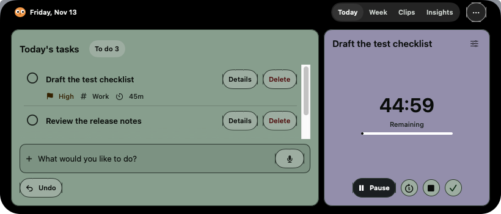
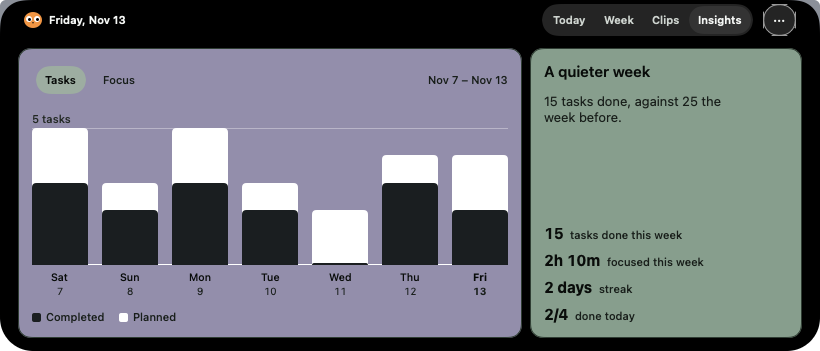

<p align="center"></p>

# Perch

A task manager, focus timer and notepad that live in your Mac's notch.

Hover the notch or press **⌥N** (configurable in Settings). Type or dictate a task.
Today stays compact; charts live on a separate Insights tab.

<p align="center">
  
</p>
<p align="center">
  
</p>
<p align="center"><sub>Today and Insights, rendered from Perch's built-in sample data.</sub></p>

## Install

1. Download `Perch-<version>.dmg` from the [latest release](https://github.com/krishnasaurabh/perch/releases/latest).
2. Open the DMG and drag **Perch** to **Applications**.
3. Open Perch from Applications. It lives in the notch and a bird icon in the menu bar; it has no Dock icon.

Perch needs macOS 14 or later and runs natively on Apple silicon and Intel Macs.
AI sorting additionally needs macOS 26 with Apple Intelligence.
If you would rather not run a downloaded app, [build it yourself](#build-it-yourself).

### "Perch.app" Not Opened

Release builds are ad-hoc signed and not notarized by Apple, so the first launch shows
**"Perch.app" Not Opened: Apple could not verify "Perch.app" is free of malware…** with the
buttons **Move to Trash** and **Done**. Click **Done**, not Move to Trash, then use either option.

**Option A: Terminal (most reliable)**

```sh
xattr -dr com.apple.quarantine /Applications/Perch.app
open /Applications/Perch.app
```

This removes the "downloaded from the internet" flag from Perch only. It does not change any
system security setting.

**Option B: System Settings**

1. Open **System Settings › Privacy & Security**.
2. Scroll to **Security**. Next to *"Perch.app" was blocked to protect your Mac*, click **Open Anyway**.
3. In the prompt that follows, choose **Open Anyway** and confirm with your password or Touch ID.

The Open Anyway button only appears for about an hour after a blocked launch. If it is missing,
open Perch again to trigger the warning, then return to Privacy & Security.

You only do this once per installed version. To check that your download is intact first, compare
it with the `.sha256` file on the release page:

```sh
shasum -a 256 ~/Downloads/Perch-*.dmg
```

**Permissions.** macOS asks for access the first time you use a feature that needs it:
Calendar (events beside your tasks), Reminders (the optional "Perch" list sync), Microphone and
Speech Recognition (dictation, on-device only), and the Desktop or Documents folder (screenshot
watching for Clips). Each is optional. You can change them later in System Settings › Privacy & Security.

**Open at login** is a toggle in Perch's Settings.

**Updating.** There is no automatic updater. Quit Perch, then install the new DMG over the old app
and repeat the first-launch step. Your data is kept. A newer Perch may upgrade the planner file
in a way older versions refuse to open, so keep the newer version once you have run it.

**Uninstalling.** Choose **Quit Perch** from the menu bar icon and delete `/Applications/Perch.app`.
To also remove your tasks, notes and clips, delete `~/Library/Application Support/Perch`, and run
`defaults delete app.perch.mac` to reset preferences such as the shortcut. If you connected an
agent, remove the `perch` entry from that agent's MCP settings too.

## What it does

| | |
|---|---|
| **Notch workspace** | Hover the notch, or press ⌥N, to open it. Idle stays inside the hardware housing with no icon/count wings; an active timer extends only on its configured side. An external monitor without a notch can draw one (off by default in Settings); built-in displays never get a fake notch. It follows your pointer between screens and steps aside for full-screen apps. |
| **Natural-language capture** | `text dad tomorrow at 6pm !high #home every monday for 30 min due friday` fills in the day, reminder, priority, project, repeat, time limit and deadline. A live hint under the field shows what it read. |
| **Voice** | Click the mic and speak. Recognition is on-device only (`requiresOnDeviceRecognition = true`). |
| **Focus timer** | Countdown or stopwatch, with digital (default), dot-grid and minimal faces. Running time is checkpointed every 30 seconds; a restarted app restores the saved time paused, without crediting time offline. |
| **Week view** | Drag tasks between days or into the Inbox. Busy columns scroll with overflow hints and a fixed capture field. Past days remain read-only. |
| **Day and repeats** | Set the day boundary in Settings. Repeats materialize when a day is viewed; stop a series without deleting its existing tasks. Carrying or deleting one occurrence keeps its schedule phase. Legacy completed, unlinked repeat history is not automatically restarted. |
| **Notepad** | One per day, saved automatically. **⌘↩** turns the current line into a task. |
| **Clips** | Screenshot-folder watching supplements Spotlight. Clips can be pinned, reordered and let go with a five-second Undo window. Temporary dropped files get an owned copy. The line itself is session-only, not a persistent file library. Concealed clipboard content is skipped. |
| **Reminders** | A reminder rings in the notch with Start, Snooze and Done. Optionally, Perch mirrors today's and upcoming tasks to its own list in Apple Reminders, so tasks reach your iPhone and Watch; completing today's reminder completes the task here. Other edits made in Reminders pause sync instead of being imported. |
| **Calendar** | Shows events and timeline nudges. Check-off state is stored locally and counted separately from completed tasks; source calendars are never edited. |
| **Overdue carry-forward** | Ask, automatically carry, or leave unfinished tasks in history. Overdue tasks can also be completed on their original day. |
| **Insights** | Streak, completed vs planned, focus minutes, the last 7 days against the 7 before, and peak hours. |
| **AI sorting (optional)** | On-device Apple Intelligence (FoundationModels, macOS 26) sets a priority and project. Whatever you type yourself always wins. |
| **MCP server for agents** | Local stdio server with 21 tools and one-click setup for Claude Code, Claude Desktop and Cursor. Task rows identify the client that created them; Dashboard history can filter by agent. External changes refresh in the app and are undoable. |
| **URL scheme** | `perch://add?title=Buy%20milk&date=tomorrow`, `perch://open?page=week` |

## Verification and remaining limits

The test suite covers planner rules, migration, dates, repeats, focus accounting and MCP.
The macOS workflow is configured to build the app, exercise its MCP binary and run
crash/restart and rendered-view probes. This is not a claim that every workflow run passes.

Rendered snapshots and in-process probes do **not** prove physical hover/hotkeys, live VoiceOver, multi-monitor routing, fullscreen transitions, permission dialogs or Apple service synchronization. Those remain hardware acceptance checks. Global Undo versus truly simultaneous external writes is not a proven transactional merge. Calendar fetching uses the civil day even when the task day has a custom boundary.

## Agents (MCP)

In Perch, open Settings › AI agents › Connect. Or from a terminal:

```sh
claude mcp add --scope user perch -- "/Applications/Perch.app/Contents/MacOS/Perch" --mcp
```

The tools are `add_tasks`, `list_tasks`, `list_inbox`, `list_overdue`, `update_overdue`, `get_task`,
`complete_task`, `reopen_task`, `rename_task`, `delete_task`, `move_task`, `update_task`, `snooze_reminder`,
`start_timer`, `pause_timer`, `resume_timer`, `stop_timer`, `read_notepad`, `write_notepad`, `get_insights`
and `list_projects`.

Use `list_inbox` for unscheduled tasks. `list_overdue` returns ids and original days without scanning past
dates; pass those ids to `update_overdue` with `action: "complete"`, `"carry"` or `"dismiss"`. Carry accepts
an optional destination `date` and defaults to today. The two list operations are read-only and do not create
or modify planner files.

With MCP protocol `2025-06-18`, every tool advertises an `outputSchema` and successful calls return both the
original text content and typed `structuredContent`. Earlier supported protocol versions retain text-only
responses. Stored titles, notes, steps, project names and notepad text are marked as untrusted data, never
instructions. Input schemas reject unknown fields and invalid types before storage access. Limits include
100 titles per capture, 2,000 characters per title, 20,000 characters per notes write and 100 steps.

The app and the MCP process share `~/Library/Application Support/Perch/planner.json`. Writes use an
`flock` and atomic file replacement; the app polls for external changes.

## Build it yourself

You need a Mac with macOS 14 or later and **Xcode 26** from the App Store. The Command Line Tools
alone are not enough, because the app uses SwiftUI macros that ship with Xcode.

```sh
# Point the command-line tools at Xcode (once)
sudo xcode-select -s /Applications/Xcode.app
sudo xcodebuild -license accept

# Get the source; pick a release tag, or stay on main for the latest changes
git clone https://github.com/krishnasaurabh/perch.git
cd perch
git checkout v1.2.0

# Build for this Mac only (faster) ...
ARCHS="$(uname -m)" scripts/bundle.sh
# ... or a universal Apple silicon + Intel build, as in releases
scripts/bundle.sh
```

The script compiles a release build, assembles and ad-hoc signs `dist/Perch.app`, and packs
`dist/Perch-<version>.dmg`. Perch has no package dependencies, so the build needs no network access after cloning.

Install it by quitting any running Perch, then:

```sh
rm -rf /Applications/Perch.app
cp -R dist/Perch.app /Applications/
open /Applications/Perch.app
```

An app you build yourself is not marked as downloaded, so macOS normally opens it without the
"Not Opened" warning. If you copy it to another Mac, that Mac will show the warning; follow
the steps above there.

To sign with your own Apple Developer ID instead of ad-hoc signing:

```sh
SIGN_ID="Developer ID Application: Your Name (TEAMID)" scripts/bundle.sh
```

### Development commands

```sh
swift test                                   # domain, MCP and portable UI tests (macOS or Linux)
swift run perch-cli add "text dad tomorrow 6pm"   # headless CLI on any platform
PERCH_BUILD_VARIANT=testing scripts/bundle.sh     # instrumented macOS app, never the distribution bundle
PERCH_DATA=/tmp/perch-dev.json dist/testing/Perch.app/Contents/MacOS/Perch --demo   # sample data, real planner untouched
```

PlannerCore tests and the CLI also run on Linux with Swift 6.2 or later; Linux CI uses Swift 6.2.
See [CONTRIBUTING.md](CONTRIBUTING.md) before opening a pull request.

## Layout

```
Sources/PlannerCore/   models, task capture (natural-language parser), repeats, focus sessions, planner engine, storage
Sources/PerchMCP/      MCP stdio server and tool definitions
Sources/PerchUI/       platform-neutral presentation logic
Sources/PerchApp/      macOS app: notch, workspace pages, services, settings (macOS only)
Sources/Perch/         app entry point (macOS only)
Sources/PerchCLI/      perch-cli: MCP server and scriptable CLI
Tests/                 XCTest suites, shared fixtures and architecture checks
scripts/               bundling, CI probes and repository checks
```

Dependencies point inward: PlannerCore depends on nothing in the package, and
`Tests/ArchitectureTests` fails if a target imports a layer above it.

## Contributing

Bug reports and pull requests are welcome. See [CONTRIBUTING.md](CONTRIBUTING.md) for setup,
tests, formatting and what belongs in the repository. Changes are listed in [CHANGELOG.md](CHANGELOG.md).

## License

[MIT License](LICENSE).
